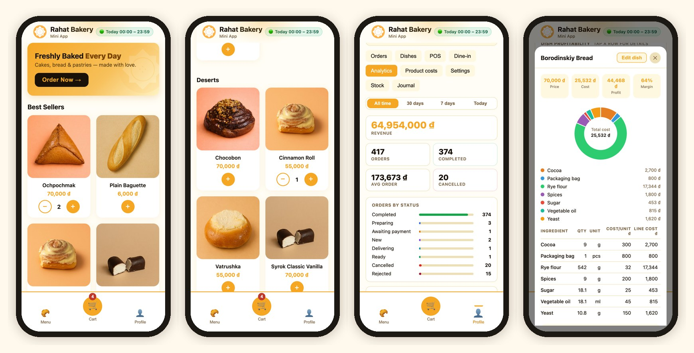
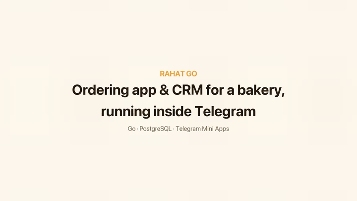
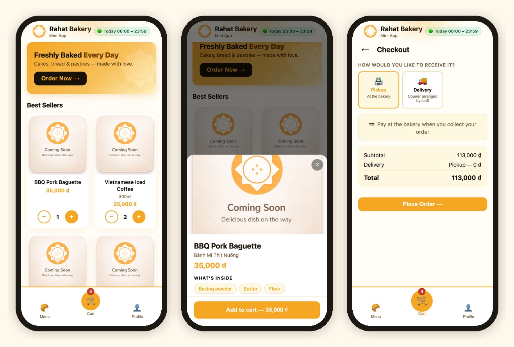
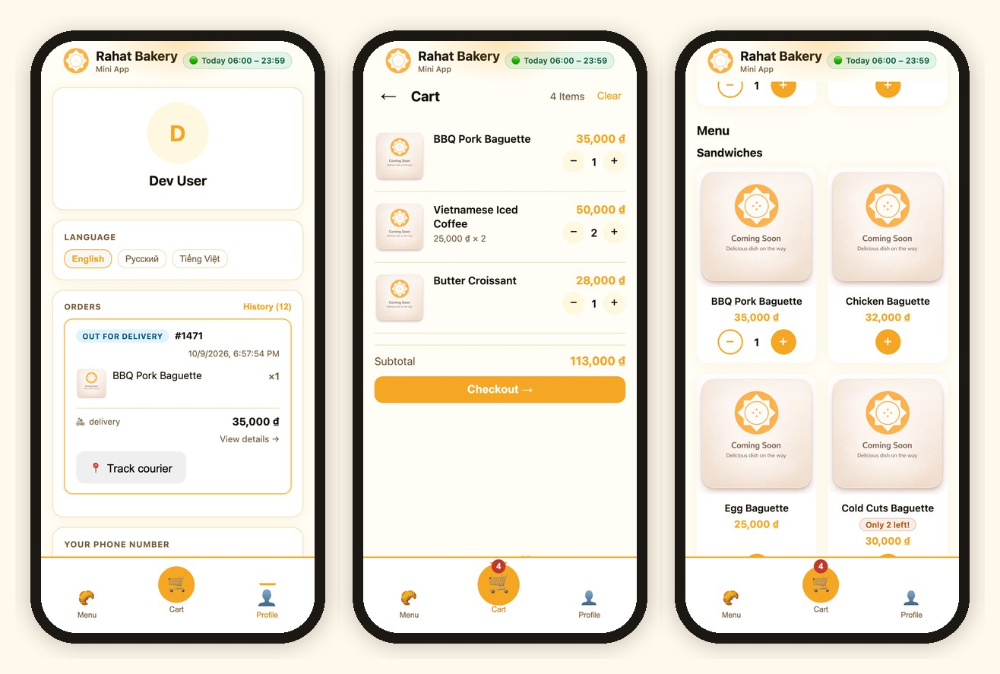
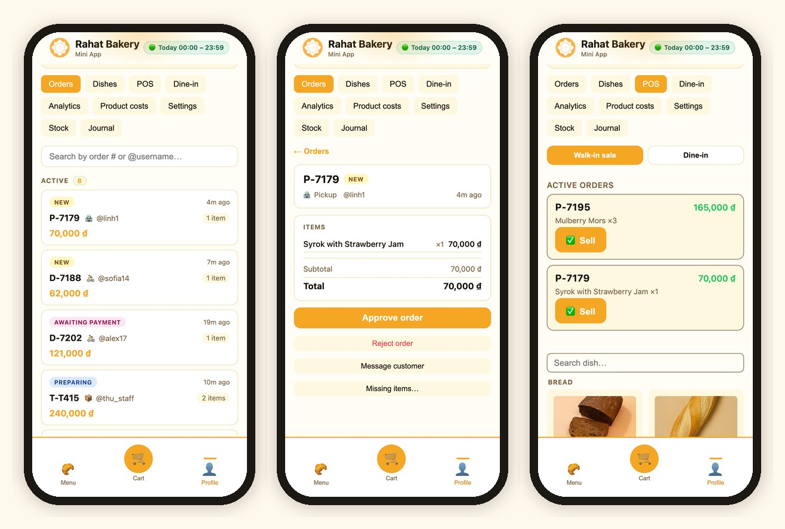
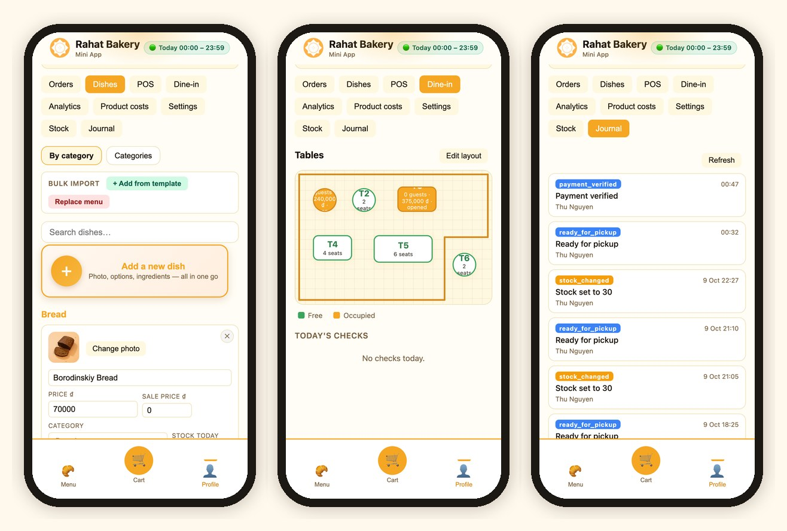
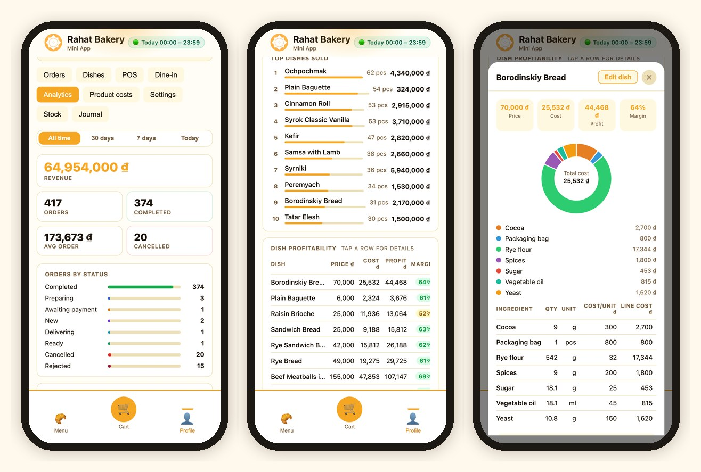
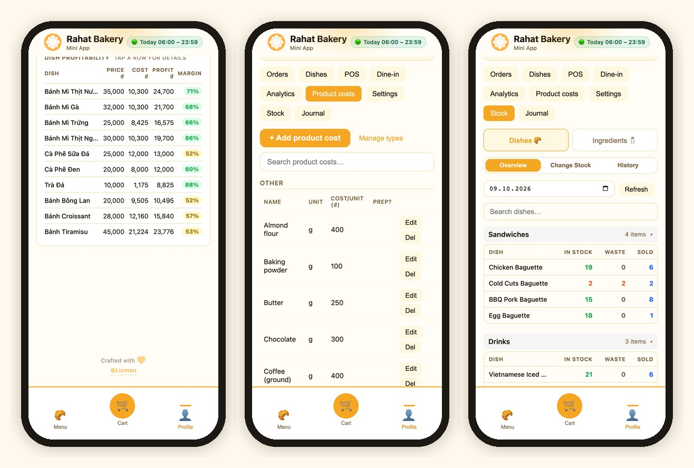
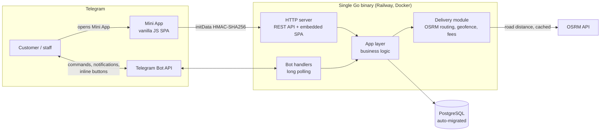
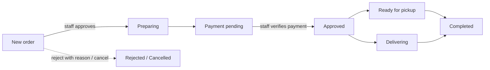

# Rahat Go — Telegram ordering app & CRM for a bakery

**Rahat Go** is a Telegram Mini App and bot that runs a small bakery end to end. Customers browse the menu, order for pickup or delivery and pay by QR without leaving Telegram. Staff use the same app as a CRM to process orders, sell walk-ins, manage the menu, track stock and see what every dish earns.

I built it for a friend's bakery in Da Nang, Vietnam, which makes Russian and Tatar home-style baking (ochpochmak, syrniki, rye breads, cottage-cheese desserts), and shaped every feature around how his team actually works. The staff used it for **3+ months** to run orders, inventory and daily stock.

> **The source code is private.** This repository is a showcase: what the app does, how it's built, and how I built it with an AI-agentic workflow. A live demo is available on request: [t.me/Licman](https://t.me/Licman).

## Demo

An 80-second walkthrough: a customer orders in Telegram, staff approve the order, then the analytics, the per-dish price playground and daily stock. [Full-quality MP4](docs/rahat-go-demo.mp4).

---

## At a glance

| | |
|---|---|
| **Role** | Sole developer: product, architecture, backend, frontend, deployment |
| **Stack** | Go · PostgreSQL · vanilla JavaScript · Telegram Bot API & Mini Apps · OSRM · Docker · Railway · GitHub Actions |
| **Size** | ~14.5k lines of Go, ~18k lines of JS/HTML/CSS · 160 commits · 27 pull requests |
| **Timeline** | March 2026 – present |
| **Languages** | English, Russian, Vietnamese (switchable in-app) |
| **Built with** | Claude Code, using custom sub-agents (see [How it was built](#how-it-was-built)) |

---

## For customers

- **Menu** with best sellers, discounted offers and categories. Dishes can have options (size, flavour) with price modifiers.
- **Cart and checkout** with **pickup** or **delivery**. Delivery uses a map picker and saved addresses, and you can order for someone else with a separate recipient name and phone.
- **Delivery fee calculated from real road distance** (OSRM routing), with service-area checks and the bakery's opening hours enforced at checkout.
- **QR bank-transfer payment** or cash. The customer taps "I have paid" and staff verify the payment.
- **Live order status** pushed as Telegram messages: approved, preparing, ready, out for delivery.
- **Order history** and the active order's status on the profile screen.

---

## For staff: orders, POS and dine-in

- **Order pipeline:** new → preparing → payment → ready for pickup / delivering → completed. Rejecting an order requires a reason, which the customer receives.
- **Readable order codes** by type: `P-` pickup, `D-` delivery, `C-` counter/POS, `T-` table.
- **Missing-items flow:** if something has sold out, staff mark it. The customer gets a Telegram message with buttons to continue without that item or to cancel, and the order total is recalculated.
- **POS mode** for walk-in sales, with no Telegram account needed for the buyer.
- **Dine-in:** a floor-plan editor (draw walls, drag tables), table occupancy, and per-person checks.
- **Roles:** buyer, manager and admin. Managers join through expiring invite links.

- **Menu management** inline on each dish card: photo, prices and sale price, category, options, daily stock. Plus a bulk JSON menu import.
- **Activity journal:** an audit log of who changed what and when (orders, prices, stock, menu).

---

## Analytics: what every dish earns

This is the part the owner used most. The data was already in the system (orders, recipes, ingredient prices), so the app turns it into answers to two questions: **what sells** and **what makes money**.

**Sales dashboard** (filter: all time / 30 days / 7 days / today):
- Revenue, total orders, completed, cancelled and average order value.
- Orders by status, so stuck or cancelled orders are easy to spot.
- **Top dishes sold**, ranked by quantity with revenue for each, which shows the real best sellers and what they bring in.

**Dish profitability:**
- A table of every dish with **price, cost, profit and margin**, and a colour-coded margin badge.
- Tap a dish to open its **cost breakdown**: a donut chart of where the cost goes, plus each ingredient line (quantity × cost per unit = line cost).
- A **price playground** inside that breakdown: try a new selling price or quantity and see profit and margin update instantly, without changing real data.

**Product costs:**
- Ingredients with units, ingredient types, and costs per unit down to fractions of a đồng (e.g. 9.5 ₫/g).
- **Prep ingredients:** composite items such as a dough or cream made from other ingredients. Their cost is calculated from the batch and divided by how much the batch yields.
- Recipes link dishes to ingredients, so changing an ingredient price instantly updates every affected dish's cost and margin.

**Stock:**
- A **daily stock model per dish: In stock / Waste / Sold**, by day, grouped by category, with search.
- **Change Stock** and **History** tabs: every addition and every write-off is logged with who did it and when.
- **Ingredient stock** with day-to-day carry-forward.
- Overselling is prevented: cart and checkout validate against live stock.

---

## Settings and white-labeling

- Opening hours with timezone, a "closing soon" banner, an emergency **force closed** switch, and a toggle to turn delivery off.
- Delivery service radius and fee rules: fee per 500 m of road distance with min/max clamps.
- **White-label by design:** business name, logo, brand colour, currency and optional features (dine-in) live in runtime settings, not in code. Onboarding a new business means a new deployment, not a fork.

---

## Architecture

**Engineering highlights:**
- **One binary, one deploy.** The Telegram bot, REST API and Mini App frontend (embedded with `embed.FS`) ship together. No separate frontend hosting.
- **Telegram-native auth.** Every API call is authenticated by validating Telegram's signed `initData` (HMAC-SHA256). Opening the app outside Telegram is blocked.
- **Self-migrating schema.** A fresh PostgreSQL database is fully set up on first boot, which makes test and production environments cheap to create.
- **Delivery pricing:** road distance from OSRM, cached in memory, with a straight-line (Haversine) fallback. Geofencing enforces the service radius.
- **Stock integrity:** stock is checked when items are added to the cart and again at checkout, so two buyers can't buy the same last croissant.
- **Separate test and production** environments on Railway, each with its own bot and database. CI (gofmt, go vet, build) runs on every pull request, and a `/healthz` endpoint feeds uptime monitoring.

### Order lifecycle

Rejection or cancellation is possible at any stage before completion.

---

## How it was built

I built Rahat Go with **Claude Code**, using an agentic workflow I set up for this project:

- **Specialised sub-agents**, each with its own area: `backend-core` (domain and storage), `web-api` (HTTP/REST), `mini-app` (frontend), `telegram-bot`, and `delivery` (routing and fees). A `task-orchestrator` agent splits each feature across them.
- **Project context in `CLAUDE.md`:** architecture, the API map, environment variables, the release flow, and rules such as "anything bigger than a small fix goes on its own branch".
- **Branch-per-feature with pull-request review:** 27 PRs, each reviewed and merged by me.

My job was the part AI can't do alone: talking to the owner and turning his day into features, deciding the architecture and data model, reviewing every change, debugging in production, and running releases.

---

## About the screenshots

The screenshots come from a local copy of the app running in a browser. **The menu and photos are real**: the bakery's 56 dishes with their actual prices. **Orders, stock and recipe costs are generated** (about five weeks of activity with realistic Da Nang ingredient prices), so no real customer or sales data is shown.

---

## Contact

**Ruslan Akhmetvaleev**: QA automation engineer (fintech) who also builds apps for small businesses.

[LinkedIn](https://www.linkedin.com/in/licman) · [GitHub](https://github.com/LicBoy) · [Telegram](https://t.me/Licman)

Want something like this for your café, bakery or shop? Get in touch.
